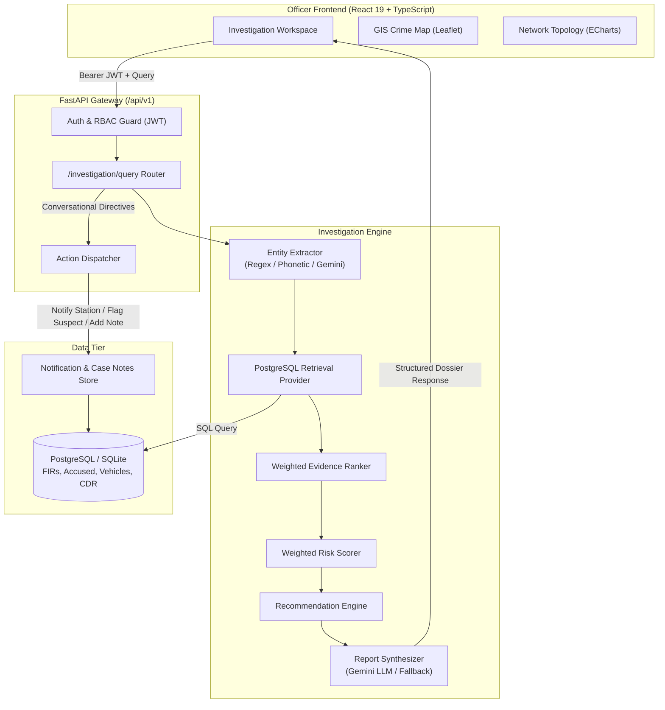

<div align="center">


  

# KSP Crime Intelligence Platform

**AI-assisted criminal intelligence synthesis, multi-source record linkage, and automated investigation dossiers for Karnataka State Police.**

[](https://github.com/dhanu-17-git/KSP_Crime-_Intelligence_Platform/actions/workflows/ci.yml)
[](LICENSE)
[](https://www.python.org/)
[](https://react.dev)
[](https://fastapi.tiangolo.com)

[**📄 Specification Docs**](docs/KSP_AI_Investigation_Build_Spec.md) · [**⚖️ License**](LICENSE)

---

> **Demo Credentials** — `Officer ID: IPS001` · `Password: demo123`

</div>

---

## Why This Exists (The Problem It Solves)

Law enforcement officers frequently combat fragmented intelligence distributed across disconnected data silos—FIR registries, ANPR (Automatic Number Plate Recognition) logs, suspect records, arrest warrants, and call detail records (CDR). Cross-jurisdictional investigations between police stations require hours of manual paperwork, phone inquiries, and ad-hoc record correlation.

The **KSP Crime Intelligence Platform** bridges these gaps by providing an authoritative, AI-assisted investigation copilot:
- Accepts **free natural language input** from investigating officers (e.g. *"Find all suspects linked to vehicle KA05MJ4421 in Koramangala"*).
- Extracts entities (suspect names, registration numbers, FIR IDs, locations) and executes **phonetic cross-table queries**.
- Computes multi-factor **risk assessment scores** and generates structured, court-admissible dossiers in seconds.
- Enables **agentic actions**: allows officers to trigger real-time station alerts, flag flight-risk suspects, and append official case notes directly from the console.

---

## Key Features

- **Multi-Stage AI Investigation Pipeline** — Dissects natural language queries into extracted entities, runs targeted database retrieval, scores evidence relevance, and generates structured intelligence dossiers.
- **Phonetic & Fuzzy Suspect Matching** — Uses Soundex and Metaphone algorithms to catch alias variants and spelling discrepancies across Kannada and English police records.
- **Interactive Criminal Network Graph** — Visualizes syndicate hierarchies, co-accused associations, shared getaway vehicles, and multi-case links using Apache ECharts.
- **Geospatial GIS Crime Mapping** — Interactive Leaflet map displaying live crime hotspots, station jurisdictions, and patrol routes across Karnataka.
- **Conversational Action Execution** — Direct command execution to dispatch station notifications, mark suspects as high-risk threats, and add timestamped case notes with full audit logging.
- **Role-Based Access Control (RBAC)** — Stateless JWT authentication enforcing granular permissions (`run_ai_queries`, `read_cases`, `flag_suspects`, `admin_override`) for Officer, Inspector, and Admin roles.
- **Bilingual Interface** — Complete UI localization supporting both English and Kannada (ಕನ್ನಡ) for field personnel.
- **Offline & Graceful Fallback Architecture** — Operates deterministically via local regex extraction and rule-based heuristic scoring if cloud AI providers or external networks are unavailable.

---


## Tech Stack

| Layer | Technology | Description |
| :--- | :--- | :--- |
| **Frontend UI** | React 19, TypeScript, Vite | Single-page application with responsive layouts |
| **Styling** | Tailwind CSS v4, Lucide Icons | Clean, high-contrast law enforcement theme |
| **Data Visualization** | Apache ECharts, Leaflet.js | GIS heatmaps and criminal network topology graphs |
| **Backend Framework** | FastAPI (Python 3.11 / 3.13) | High-performance asynchronous REST API |
| **Data Layer & ORM** | SQLAlchemy 2.0 (Async), Alembic | Asynchronous querying with schema migrations |
| **Databases** | PostgreSQL (Neon serverless) / SQLite | Cloud Postgres for production with local SQLite fallback |
| **AI Synthesis** | Google Gemini API (`gemini-flash-latest`) | Formal report authoring with function calling tools |
| **Authentication** | JWT (`python-jose`), Passlib | Stateless token auth with role & permission enforcement |
| **Testing & Quality** | Pytest, pytest-asyncio, Oxlint | Comprehensive backend unit testing & frontend linting |
| **Deployment & Containers** | Docker, Docker Compose | Production containerization and local orchestration |

---

## Architecture Overview



---

## Project Structure

```text
.
├── .github/
│   └── workflows/
│       ├── ci.yml               # Automated test, lint, and Docker build pipeline
│       └── security.yml         # Security vulnerability and secret audit
├── backend/
│   ├── app/
│   │   ├── api/                 # API routers (investigation, health, v1, auth)
│   │   ├── core/                # Settings, database engine, logging, security
│   │   ├── database/            # Database session factory and base declarative
│   │   ├── dependencies/        # FastAPI dependencies (auth, permissions)
│   │   ├── investigation/       # 4-stage investigation pipeline & AI providers
│   │   ├── models/              # SQLAlchemy ORM models (FIR, Accused, Vehicle)
│   │   ├── repositories/        # Database access layer
│   │   ├── schemas/             # Pydantic request/response schemas
│   │   ├── seed.py              # Synthetic demo dataset generator
│   │   └── utils/               # Phonetic algorithms, exceptions, responses
│   ├── alembic/                 # Database schema migrations
│   ├── tests/                   # Pytest test suite (14 test cases)
│   ├── Dockerfile               # Production container definition
│   └── requirements.txt         # Python dependencies
├── docs/
│   ├── images/                  # Documentation screenshots and placeholders
│   └── KSP_AI_Investigation_Build_Spec.md  # Product architecture specification
├── src/
│   ├── pages/                   # AIWorkspace, Dashboard, Suspects, Vehicles, Map
│   ├── components/              # Shared UI components, Header, Sidebar
│   ├── context/                 # Application and authentication context
│   └── services/                # Backend API client & local mock fallbacks
├── .env.example                 # Environment configuration template
├── package.json                 # Frontend dependencies and scripts
└── vite.config.ts               # Vite bundler configuration
```

---

## Setup and Run Instructions

### Prerequisites
- **Node.js**: `v20.x` or `v22.x`
- **Python**: `3.11+` or `3.13`
- **Git**

---

### 1. Clone & Configure

```bash
git clone https://github.com/dhanu-17-git/KSP_Crime-_Intelligence_Platform.git
cd KSP_Crime-_Intelligence_Platform

# Create root environment file
cp .env.example .env
```

---

### 2. Backend Setup (FastAPI)

```bash
cd backend

# Create and activate Python virtual environment
python -m venv .venv
source .venv/bin/activate       # On Linux / macOS
# .venv\Scripts\activate        # On Windows (PowerShell)

# Install dependencies
pip install -r requirements.txt

# Create backend environment configuration
cp .env.example .env
```

Configure your `backend/.env` file with appropriate values:
```env
ENVIRONMENT="development"
DATABASE_URL="sqlite+aiosqlite:///./ksp_crime_intel.db"
JWT_SECRET_KEY="replace-with-a-random-32-byte-secret"
AI_PROVIDER="none"   # Change to 'gemini' and supply GEMINI_API_KEY for live LLM
```

Seed the local demo database and start the server:
```bash
# Seed synthetic police dataset (Cases, Suspects, Vehicles, Officers)
python -m app.seed

# Start Uvicorn development server
python -m uvicorn main:app --host 127.0.0.1 --port 8000 --reload
```

- API Base URL: `http://127.0.0.1:8000/api/v1`
- Interactive OpenAPI Docs: `http://127.0.0.1:8000/docs`

---

### 3. Frontend Setup (React + Vite)

From the project root:

```bash
# Install frontend dependencies
npm install

# Start Vite development server
npm run dev
```

- Web UI: `http://localhost:5173`
- Demo Login: `IPS001` / `demo123`

---

### 4. Running Verification & Tests

```bash
# Frontend linting
npm run lint

# Frontend production build
npm run build

# Backend test suite (all 14 test cases)
cd backend
pytest tests/ -v
```

---

### 5. Running with Docker

```bash
# Build Docker image
docker build -t ksp-crime-intel-api backend/

# Run containerized backend
docker run -p 8000:8000 \
  -e ENVIRONMENT="test" \
  -e DATABASE_URL="sqlite+aiosqlite:///./ksp_crime_intel.db" \
  -e JWT_SECRET_KEY="docker-secret-key" \
  -e AI_PROVIDER="none" \
  ksp-crime-intel-api
```

---

## Roadmap

- [ ] **Redis-Backed Session Management** — Move in-memory conversational thread store to distributed Redis for multi-instance high availability.
- [ ] **Live ANPR Stream Ingestion** — Real-time WebSocket streaming from traffic junction cameras with instant stolen vehicle alerts.
- [ ] **Biometric Facial Recognition Integration** — Cross-matching surveillance camera snapshots against state CCTNS facial databases.
- [ ] **Voice-to-Dossier Audio Transcription** — Real-time voice note transcription supporting native Kannada dialects for officers on field patrol.
- [ ] **Interstate Intelligence Federation** — Federated querying interface across neighboring state law enforcement databases (Kerala, Tamil Nadu, Andhra Pradesh).

---

## License

This project is licensed under the [MIT License](LICENSE) — see the LICENSE file for details.
